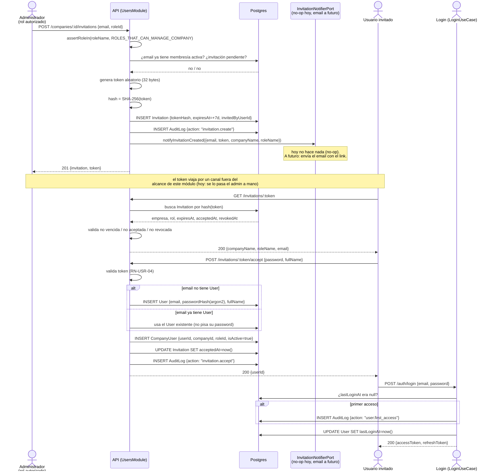

# Sprint 1 — Módulo 2: Usuarios, Roles, Permisos e Invitaciones

Corresponde a M01 (Acceso y seguridad, parcial) del documento fuente y a la
pantalla P15. Completa el flujo "Alta de usuario" de la tabla de flujos críticos:
*Administrador invita → usuario acepta → define contraseña → se asigna rol y
empresas → primer acceso auditado.*

Estado: **implementado y verificado. Ver §8 para el resultado real.**

## 0. Decisiones previas

### 0.1 Deuda técnica heredada del Módulo 1 — se paga ahora

El documento de Módulo 1 dejó anotado explícitamente: *"el chequeo de rol en este
módulo es un helper local mínimo... cuando el Módulo 2 aporte ese mecanismo
genérico, este módulo se migra a usarlo"*. Este módulo necesita exactamente lo
mismo que ya usa Empresas (autorizar por rol, auditar en `AuditLog`), así que en
vez de duplicarlo dentro de `modules/users/`, se relocalizan a un lugar compartido
**antes** de escribir el código de este módulo:

| Se mueve | De | A |
|---|---|---|
| `assertRoleIn` + `RoleNotAuthorizedError` | `modules/companies/domain/rules/company-roles.ts` | `common/domain/rules/assert-role.ts` |
| `AuditLogRepository` (puerto) | `modules/companies/domain/repositories/audit-log.repository.ts` | `common/domain/repositories/audit-log.repository.ts` |
| `PrismaAuditLogRepository` (impl) | `modules/companies/infrastructure/...` | `common/infrastructure/persistence/prisma-audit-log.repository.ts` |
| `ROLES_THAT_CAN_MANAGE_COMPANY` / `ROLES_THAT_CAN_CREATE_COMPANY` | `modules/companies/domain/rules/company-roles.ts` | `common/domain/rules/company-roles.ts` (mismo archivo, nueva carpeta) |

`modules/companies/**` se actualiza para importar desde la nueva ubicación
compartida (mismo comportamiento, mismos tests — **no se toca ninguna regla de
negocio de Módulo 1**, solo la ubicación física). Se re-corren los 31 tests
existentes después del refactor para confirmarlo antes de seguir.

`AuditLogRepository` se sigue registrando como provider en cada módulo que lo usa
(AuthModule, CompaniesModule, el nuevo UsersModule) — mismo patrón ya establecido
en este proyecto para `PrismaService` (se declara en cada módulo, no hay un
"CommonModule" compartido todavía; no se introduce esa abstracción nueva sin que
haga falta).

### 0.2 Alcance explícitamente excluido de este módulo (y por qué)

- **Envío real de emails**: no hay proveedor de correo configurado (SMTP/
  SendGrid/etc. — el stack propuesto en el documento fuente lo deja para más
  adelante). El token de invitación en texto plano se devuelve en la respuesta de
  `POST /companies/:id/invitations` (solo visible para quien invita, que ya tiene
  rol autorizado) para poder probar el flujo completo sin infraestructura de
  correo. **Esto es una limitación real, no una simulación**: en producción no
  puede quedar así, hay que conectar un proveedor de email antes de salir a
  producción. Se dice explícitamente para no dar una falsa sensación de
  "terminado".
- **Recuperación de contraseña** (`/auth/forgot-password`, M01): es un flujo
  distinto — token para un usuario que ya existe y olvidó su contraseña, no para
  altas nuevas. Comparte la idea de "token de un solo uso" con las invitaciones
  pero es una entidad y un caso de uso aparte. Queda pendiente para un módulo
  posterior.
- **Bloqueo por intentos fallidos de login** (M01): es un endurecimiento del
  `LoginUseCase` de autenticación, no de gestión de usuarios/roles. Queda
  pendiente.
- **Matriz de permisos por módulo/pantalla** (más allá de "quién administra la
  empresa"): el documento fuente no define todavía una matriz fina de permisos
  por acción (ver §22 "Cerrar matriz de roles y permisos" — sigue abierto como
  decisión pendiente del proyecto). Este módulo reutiliza la misma distinción de
  Módulo 1 (roles de administración vs. el resto); una matriz más fina se
  construye cuando haya una decisión de producto que la respalde, no antes.

### 0.3 Confirmaciones y ajustes pedidos antes de programar

1. **Invitation independiente del mecanismo de envío de email — se agrega un
   puerto que no existía en la primera versión de este documento.** Se agrega
   `InvitationNotifierPort` (dominio, `modules/users/domain/repositories/
   invitation-notifier.port.ts`) con un método `notifyInvitationCreated(input)`.
   `CreateInvitationUseCase` depende de esa interfaz, nunca de un proveedor
   concreto. La implementación de este sprint es un adaptador *no-op* (no manda
   nada; el token se sigue devolviendo en la respuesta HTTP como ya estaba
   documentado en §0.2, que sigue siendo la única vía de prueba end-to-end
   mientras no haya proveedor real). El día que se conecte SMTP, Gmail,
   Microsoft 365, SendGrid o SES, se escribe un adaptador nuevo que implemente
   el mismo puerto — **cero cambios en el caso de uso ni en ninguna regla de
   negocio**.
2. **Token nunca en texto plano**: confirmado, ya estaba en el diseño (§1.1) —
   se genera aleatorio, se hashea con SHA-256, y solo el hash se persiste. Sin
   cambios.
3. **Fechas e usuarios de la invitación — faltaba un campo.** `createdAt`,
   `expiresAt`, `acceptedAt` y `revokedAt` ya estaban. **Faltaba
   `revokedByUserId`** (quién la revocó) — se agrega al modelo (§1.1) y a
   `RevokeInvitationUseCase` (§4).
4. **Toda acción en `AuditLog`**: confirmado, ya cubierto por RN-USR-11 — las
   acciones del módulo que modifican estado (invitar, revocar, aceptar, cambiar
   rol, activar/desactivar membresía, primer acceso) quedan auditadas; las
   lecturas (listar) no, porque no modifican nada. Sin cambios.
5. **Un usuario en múltiples empresas con roles distintos**: confirmado, ya
   garantizado estructuralmente desde Sprint 0 — `User` no tiene rol propio,
   `CompanyUser` es la única fuente de rol y es por `(userId, companyId)` único,
   sin límite de cuántas empresas puede tener un mismo usuario. Sin cambios de
   diseño, se deja explícito acá porque no estaba dicho en estos términos.
6. **Ninguna autorización depende del frontend**: confirmado — todo chequeo de
   rol ocurre en el caso de uso (vía `assertRoleIn`, ahora compartido) contra el
   `roleName` que el propio backend resolvió en `CompanyContextGuard` desde la
   base de datos, nunca contra un valor que mande el cliente. El frontend puede
   ocultar botones por UX, pero el backend nunca confía en eso. Sin cambios.
7. **Diagrama de secuencia del flujo completo**: agregado en §7.

## 1. Modelo de datos

### 1.1 `Invitation` (nuevo)

```prisma
model Invitation {
  id              String    @id @default(uuid())
  companyId       String    @map("company_id")
  email           String
  roleId          String    @map("role_id")
  tokenHash       String    @map("token_hash")
  invitedByUserId String    @map("invited_by_user_id")
  revokedByUserId String?   @map("revoked_by_user_id")
  expiresAt       DateTime  @map("expires_at")
  acceptedAt      DateTime? @map("accepted_at")
  revokedAt       DateTime? @map("revoked_at")
  createdAt       DateTime  @default(now()) @map("created_at")

  company     Company @relation(fields: [companyId], references: [id])
  role        Role    @relation(fields: [roleId], references: [id])
  invitedBy   User    @relation("InvitationsSent", fields: [invitedByUserId], references: [id])
  revokedBy   User?   @relation("InvitationsRevoked", fields: [revokedByUserId], references: [id])

  @@index([companyId])
  @@index([email])
  @@map("invitations")
}
```

Dos relaciones separadas hacia `User` (`InvitationsSent` / `InvitationsRevoked`)
porque Prisma exige nombrarlas cuando hay más de una FK al mismo modelo.

**Decisión de diseño**: no hay columna `status`. El estado (pendiente / aceptada /
revocada / expirada) se calcula a partir de `acceptedAt`, `revokedAt` y
`expiresAt` — evita guardar un dato derivado que podría desincronizarse (mismo
criterio que ya se documentó en `docs/ARQUITECTURA.md` sección 8 para totales
calculados vs. persistidos, aplicado acá a estado en vez de a montos).

El token en sí **no se persiste**: se genera aleatorio (32 bytes), se hashea con
SHA-256 (no argon2 — un token de alta entropía no necesita un hash lento pensado
para contraseñas de baja entropía; mismo criterio que ya usa `RefreshToken` en
Sprint 0) y solo se guarda `tokenHash`.

### 1.2 `CompanyUser` (se le agrega un campo)

```prisma
model CompanyUser {
  // ...campos existentes sin cambios...
  isActive  Boolean  @default(true) @map("is_active")
}
```

RN-USR-09: desactivar el acceso de un usuario a una empresa no borra la membresía
(coherente con RN-003/RN-EMP-04), la marca inactiva. `CompanyContextGuard` se
ajusta para rechazar (403) una membresía con `isActive=false` como si no
existiera.

### 1.3 `User` (sin cambios de esquema, se agrega una capacidad al repositorio)

`UserRepository` (del módulo `auth`, ya existente) gana un método `create()`:
hoy solo tiene `findByEmail`/`findById`/`updateLastLogin`. Aceptar una invitación
para un email sin cuenta necesita poder crear el usuario.

## 2. Reglas de negocio

| ID | Regla |
|---|---|
| RN-USR-01 | Solo los roles `Administrador Estrategos`, `Propietario` o `Administrador de empresa` (mismo conjunto que RN-EMP-07, ahora compartido) pueden invitar, listar invitaciones, revocar invitaciones, cambiar el rol de un miembro o activar/desactivar su acceso. |
| RN-USR-02 | Toda invitación pertenece a una empresa y a un rol existente; no se puede invitar sin especificar ambos. |
| RN-USR-03 | El token de invitación nunca se persiste ni se loguea en texto plano — solo su hash SHA-256. |
| RN-USR-04 | Una invitación expira a los 7 días de creada. No puede aceptarse una invitación expirada, ya aceptada o revocada. |
| RN-USR-05 | No se puede invitar a un email que ya tiene una membresía **activa** en esa empresa. |
| RN-USR-06 | No se puede crear una nueva invitación para un email que ya tiene una invitación pendiente (no vencida, no aceptada, no revocada) en la misma empresa. |
| RN-USR-07 | Al aceptar: si el email no tiene `User`, se crea con la contraseña provista (hasheada con argon2, igual que en Sprint 0) y el nombre completo provisto. Si ya existe, se usa la cuenta existente (la contraseña provista en la aceptación se ignora — no se sobrescribe una contraseña existente por este medio). Se crea la membresía `CompanyUser` con el rol de la invitación, y la invitación queda marcada `acceptedAt`. |
| RN-USR-08 | El primer login de un usuario (`User.lastLoginAt` era `null` antes de este login) genera un evento de auditoría `user.first_access`, distinto de un login común — cubre el paso "primer acceso auditado" del flujo, sin importar si ese primer acceso vino de una invitación o de otra vía. |
| RN-USR-09 | Desactivar/activar el acceso de un usuario a una empresa no elimina la membresía (RN-003), la marca `isActive`. Repite la regla RN-EMP-06 (no se permite activar algo ya activo ni desactivar algo ya inactivo). |
| RN-USR-10 | Cambiar el rol de un usuario en una empresa se audita con el rol anterior y el nuevo. |
| RN-USR-11 | Toda acción de este módulo (invitar, revocar, aceptar, cambiar rol, activar/desactivar membresía) genera un registro en `AuditLog` (RN-009). |
| RN-USR-12 | Un usuario no puede cambiarse el rol a sí mismo ni desactivar su propia membresía (evita que alguien se bloquee a sí mismo por error o se autoasigne un rol mayor). |
| RN-USR-13 | Toda revocación de invitación registra quién la revocó (`revokedByUserId`), además de cuándo. |
| RN-USR-14 | La notificación de una invitación (hoy: ninguna; a futuro: email) se resuelve detrás de `InvitationNotifierPort` — el caso de uso nunca depende de un proveedor concreto. |

## 3. Endpoints

Todos requieren JWT. Los marcados **[CTX]** requieren `X-Company-Id` +
`CompanyContextGuard`, igual que en Módulo 1.

| Método | Endpoint | Caso de uso | Autorización |
|---|---|---|---|
| `GET` | `/roles` | `ListRolesUseCase` | Cualquier usuario autenticado |
| `GET` | `/companies/:id/members` **[CTX]** | `ListCompanyMembersUseCase` | Cualquier miembro de la empresa |
| `POST` | `/companies/:id/invitations` **[CTX]** | `CreateInvitationUseCase` | RN-USR-01 |
| `GET` | `/companies/:id/invitations` **[CTX]** | `ListInvitationsUseCase` | RN-USR-01 |
| `POST` | `/companies/:id/invitations/:invitationId/revoke` **[CTX]** | `RevokeInvitationUseCase` | RN-USR-01 |
| `GET` | `/invitations/:token` | `GetInvitationByTokenUseCase` | Público (`@Public()`) — no hay sesión todavía |
| `POST` | `/invitations/:token/accept` | `AcceptInvitationUseCase` | Público (`@Public()`) |
| `PATCH` | `/companies/:id/members/:userId/role` **[CTX]** | `ChangeMemberRoleUseCase` | RN-USR-01, RN-USR-12 |
| `POST` | `/companies/:id/members/:userId/deactivate` **[CTX]** | `DeactivateMemberUseCase` | RN-USR-01, RN-USR-12 |
| `POST` | `/companies/:id/members/:userId/activate` **[CTX]** | `ActivateMemberUseCase` | RN-USR-01 |

`GET /invitations/:token` existe para que el frontend pueda mostrar "te invitaron
a [Empresa] como [Rol]" antes de pedir la contraseña, en vez de aceptar a ciegas.
No está en la tabla de endpoints del documento fuente pero se desprende
directamente del flujo "Alta de usuario" (el usuario necesita ver qué está
aceptando).

## 4. Casos de uso

1. **`ListRolesUseCase`** — lista el catálogo de roles (para el combo de invitación).
2. **`ListCompanyMembersUseCase`** — lista `CompanyUser` + datos de `User` y `Role` de una empresa.
3. **`CreateInvitationUseCase`** — RN-USR-01/02/03/05/06/14: valida rol, valida que no haya membresía activa ni invitación pendiente duplicada, genera token, persiste el hash, llama a `InvitationNotifierPort` (no-op por ahora), audita. Devuelve el token en texto plano solo en esta respuesta (ver §0.2).
4. **`ListInvitationsUseCase`** — lista invitaciones de una empresa con su estado calculado (pendiente/aceptada/revocada/expirada).
5. **`RevokeInvitationUseCase`** — RN-USR-01/13: solo invitaciones pendientes; registra `revokedByUserId`; audita.
6. **`GetInvitationByTokenUseCase`** — resuelve el token recibido (lo hashea y busca por hash), valida que no esté vencida/aceptada/revocada, devuelve empresa y rol para mostrar antes de aceptar.
7. **`AcceptInvitationUseCase`** — RN-USR-04/07: valida el token, crea o vincula el `User`, crea la membresía, marca la invitación aceptada, audita.
8. **`ChangeMemberRoleUseCase`** — RN-USR-01/10/12: valida rol del solicitante, valida que no se esté auto-modificando, cambia el `roleId` de la membresía, audita con rol anterior/nuevo.
9. **`DeactivateMemberUseCase`** — RN-USR-01/09/12: análogo a `DeactivateCompanyUseCase` de Módulo 1, aplicado a `CompanyUser`.
10. **`ActivateMemberUseCase`** — análogo a `ActivateCompanyUseCase`.
11. **`LoginUseCase` (modificado, vive en `modules/auth/`)** — RN-USR-08: antes de actualizar `lastLoginAt`, si su valor previo era `null`, registra `user.first_access` en `AuditLog` (requiere inyectarle el `AuditLogRepository` compartido, que hoy no tiene).

## 5. Pruebas

### 5.1 Unitarias (mismo patrón que Módulo 1: repos/puertos mockeados)

- `CreateInvitationUseCase`: crea cuando el rol autoriza; rechaza si el rol no autoriza; rechaza si el email ya tiene membresía activa; rechaza si ya hay una invitación pendiente para ese email/empresa; el token devuelto en texto plano coincide con el hash persistido; llama al `InvitationNotifierPort`.
- `RevokeInvitationUseCase`: revoca una invitación pendiente y registra quién; rechaza si ya estaba aceptada o revocada; rechaza si el rol no autoriza.
- `GetInvitationByTokenUseCase` / `AcceptInvitationUseCase`: acepta una invitación válida y pendiente; crea un `User` nuevo cuando el email no existe; reutiliza el `User` existente sin pisar su contraseña cuando el email ya tiene cuenta; rechaza token inexistente, expirado, ya aceptado o revocado; crea la membresía con el rol correcto de la invitación.
- `ChangeMemberRoleUseCase`: cambia el rol cuando el solicitante autoriza; rechaza auto-modificación (RN-USR-12); rechaza si el rol del solicitante no autoriza.
- `DeactivateMemberUseCase` / `ActivateMemberUseCase`: mismos criterios que su equivalente de empresa en Módulo 1, más el rechazo de auto-desactivación.
- `LoginUseCase` (regresión + caso nuevo): sigue pasando los 4 casos de Sprint 0; nuevo caso — audita `user.first_access` solo cuando `lastLoginAt` era `null`, no en logins subsiguientes.

### 5.2 Verificación end-to-end manual (`curl` contra Postgres real, mismo método que Módulos previos)

- Invitar un email nuevo → extraer el token de la respuesta → `GET /invitations/:token` muestra empresa/rol → `POST /invitations/:token/accept` con contraseña y nombre → usuario creado → login exitoso → el login genera `user.first_access` en auditoría → un segundo login del mismo usuario NO vuelve a generarlo.
- Invitar un email que ya es miembro activo → 400 (RN-USR-05).
- Invitar el mismo email dos veces sin que acepte la primera → 400 (RN-USR-06).
- Aceptar un token ya aceptado → 400/404.
- Revocar una invitación pendiente (queda registrado quién la revocó) → luego intentar aceptarla → 400.
- Cambiar el rol de un miembro con un usuario autorizado → 200, auditoría con rol anterior/nuevo.
- Intentar cambiarse el rol a uno mismo → 400 (RN-USR-12).
- Desactivar un miembro → ese usuario pierde acceso a la empresa (403 en cualquier endpoint `[CTX]` de esa empresa) → reactivar → recupera el acceso.
- Verificar que un mismo usuario pueda quedar con roles distintos en dos empresas distintas (invitarlo a una segunda empresa con otro rol y confirmar ambas membresías).

### 5.3 Explícitamente no cubierto

- Envío real de correo (ver §0.2).
- Pruebas de integración automatizadas contra base real — igual que en Módulo 1, se verifica manualmente con `curl`.

## 6. Diagrama de secuencia — flujo completo de invitación



## 7. Archivos a tocar (para la revisión posterior)

- `apps/api/prisma/schema.prisma` — modelo `Invitation`, `CompanyUser.isActive`, migración.
- `apps/api/src/common/domain/**` (nuevo) — reubicación de `assertRoleIn`, `RoleNotAuthorizedError`, `AuditLogRepository`, listas de roles (ver §0.1).
- `apps/api/src/common/infrastructure/persistence/prisma-audit-log.repository.ts` (reubicado).
- `apps/api/src/common/guards/company-context.guard.ts` — rechaza membresías `isActive=false`.
- `apps/api/src/modules/companies/**` — se actualizan los imports al nuevo módulo compartido (sin cambios de comportamiento).
- `apps/api/src/modules/auth/domain/repositories/user.repository.ts` — nuevo método `create()`.
- `apps/api/src/modules/auth/infrastructure/persistence/prisma-user.repository.ts` — implementación de `create()`.
- `apps/api/src/modules/auth/application/use-cases/login.use-case.ts` — auditoría de primer acceso (RN-USR-08).
- `apps/api/src/modules/users/**` (nuevo módulo) — domain/application/infrastructure/presentation completos para roles, invitaciones y membresías, incluyendo `InvitationNotifierPort` y su adaptador no-op.
- `apps/api/test/companies/**` — se re-corren tal cual tras el refactor de §0.1.
- `apps/api/test/auth/login.use-case.spec.ts` — nuevo caso de auditoría de primer acceso.
- `apps/api/test/users/**` (nuevo) — specs de los casos de uso listados en §4.

## 8. Resultado real (verificado, no supuesto)

- ✅ Refactor de deuda técnica de §0.1: 31 tests de Módulo 1 siguieron pasando después de mover `assertRoleIn`/`AuditLogRepository`/listas de roles a `common/domain/`.
- ✅ `npx tsc --noEmit`: 0 errores.
- ✅ `npm run lint`: 0 errores.
- ✅ `npm test`: **59/59 tests pasan** (11 nuevos de invitaciones/miembros + 2 nuevos de auditoría de primer acceso en `LoginUseCase` + los 31 + 6 heredados, con la resta correcta por los 4 tests de login que ya existían antes de sumarles 2).
- ✅ Migración `invitations_and_company_user_active` aplicada contra Postgres real.
- ✅ Verificación end-to-end completa con `curl`, cubriendo cada punto de §5.2 y cada observación de §0.3:
  - Flujo completo: invitar → preview público → aceptar (crea `User`) → login → `user.first_access` en auditoría → segundo login NO lo repite.
  - RN-USR-05 (email con membresía activa) y RN-USR-06 (invitación pendiente duplicada): ambas rechazadas con 400.
  - Revocar invitación pendiente → `revoked_by_user_id` queda registrado en la base → revocarla de nuevo → 400. Aceptar una invitación revocada → 400.
  - Cambiar rol de otro usuario → 200, auditoría con rol anterior/nuevo. Intentar cambiarse el rol a uno mismo → 400 (RN-USR-12).
  - Desactivar a otro usuario → pierde acceso a la empresa (403 vía `CompanyContextGuard`) → reactivar → recupera el acceso. Intentar autodesactivarse → 400.
  - **Punto 5 del usuario confirmado con datos reales**: el mismo usuario (`nuevo.empleado@estrategos.local`) quedó con rol `Auditor` en una empresa y `Propietario` en otra, simultáneamente.
  - Aceptar una invitación para un email que ya tiene cuenta no pisa su contraseña: se verificó que el login con la contraseña **original** siguió funcionando después de una segunda aceptación con una contraseña distinta.

### Bugs reales encontrados y corregidos durante la verificación (no estaban en el plan)

1. **`JwtAuthGuard` no traducía un token inválido a 401** — `TokenProviderPort.verifyAccessToken` lanza un error de dominio cuando el JWT es inválido/expirado, pero el guard no lo capturaba, así que cualquier token corrupto o vencido devolvía **500** en vez de **401**. Bug heredado de Sprint 0, invisible hasta ahora porque nunca se había probado un token inválido end-to-end. **Corregido**: el guard ahora captura el error y lanza `UnauthorizedException`.
2. **Caché incremental de TypeScript rompía el build de forma recurrente** — el mismo síntoma que ya se había visto y "arreglado" en Sprint 0 volvió a aparecer dos veces más durante este módulo: `rm -rf dist && nest build` terminaba con éxito (exit 0) pero sin emitir casi ningún archivo, porque `tsconfig.build.tsbuildinfo` sigue pensando que los archivos no cambiaron aunque `dist/` ya no existe. Agregar el archivo a `.gitignore` (hecho en Sprint 0) no alcanzaba — el problema volvía cada vez que se borraba `dist/` sin acordarse de borrar también ese archivo a mano. **Corregido de raíz esta vez**: `"incremental": false` en `tsconfig.build.json`. Verificado corriendo el build dos veces seguidas sin borrar caché entre medio — ambas veces completo.

### Explícitamente no cubierto (ver §0.2)

- Envío real de email — el token se sigue devolviendo en la respuesta HTTP.
- Recuperación de contraseña, bloqueo por intentos fallidos, matriz de permisos fina — fuera de alcance de este módulo, según lo documentado.
