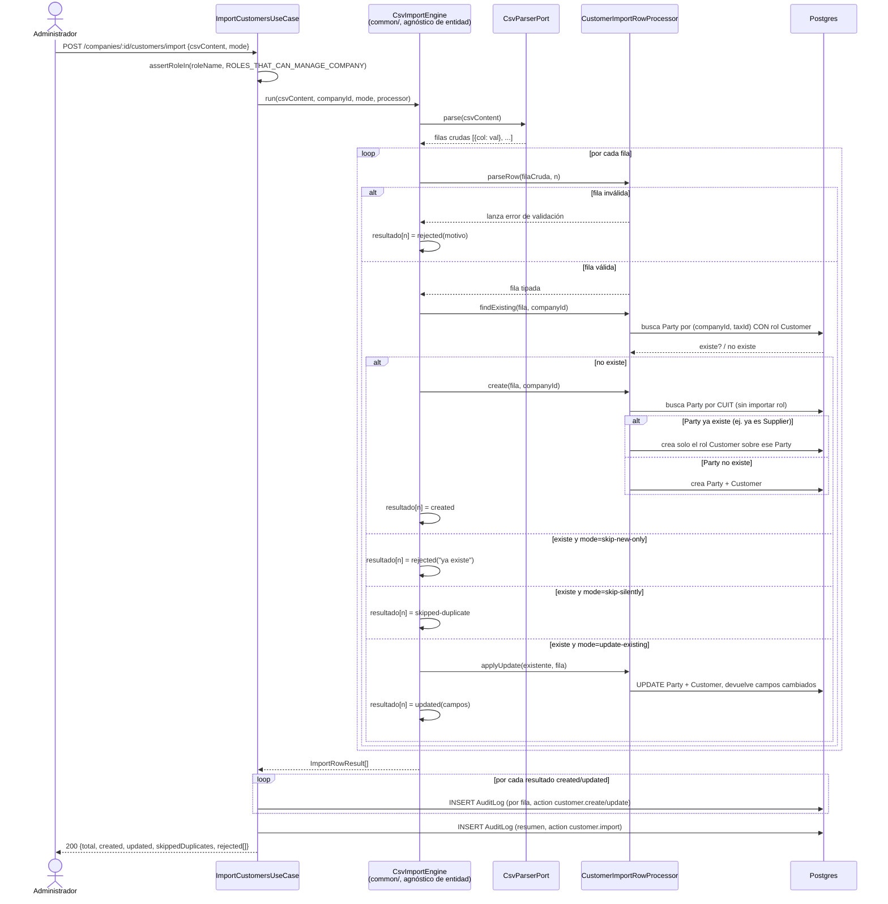

# Sprint 2 — Módulo 1: Clientes y Proveedores (Terceros)

Corresponde a M03 (Clientes) y M04 (Proveedores) del documento fuente, a las
pantallas P05/P06, y a la fila "Sprint 2 | Terceros | Clientes, proveedores,
importación CSV, fichas y documentación" de la tabla de iteraciones.

Estado: **implementado y verificado. Ver §8 para el resultado real.**

## 0. Decisiones previas

### 0.1 Un solo documento para Cliente y Proveedor

Se documentan juntos (mismo criterio que Empresa+Sucursal en Sprint 1) pero
se implementan como módulos de dominio separados. Ver razón completa en la
versión anterior de este documento (git history) — sigue vigente.

### 0.2 Deuda técnica pagada: `isValidTaxId` compartido

Se relocaliza de `modules/companies/domain/rules/` a
`common/domain/rules/tax-id.validator.ts` antes de escribir código nuevo.
`modules/companies` se actualiza para importar desde ahí (sin cambio de
comportamiento; se re-corren los 59 tests existentes).

### 0.3 Motor de importación CSV: diseño acordado (sin cambios)

Se mantiene exactamente lo acordado antes de este rediseño:

- Tres modos: `skip-new-only` (default, rechaza duplicados),
  `update-existing` (upsert, audita campos cambiados),
  `skip-silently` (omite duplicados sin error).
- Procesamiento best-effort por fila — una fila inválida no aborta las demás.
- Reporte final: total, creadas, actualizadas, omitidas por duplicado,
  rechazadas con motivo.
- Nunca se permite un CUIT duplicado dentro de la misma empresa — reforzado
  a nivel de base de datos.
- CSV recibido como texto en el body JSON, no `multipart/form-data`.
- Librería `csv-parse` (dependencia nueva).

Lo que cambia respecto de la versión anterior de este documento es **dónde**
vive esta lógica (ver §0.5) y **qué significa "duplicado"** ahora que existe
un Tercero compartido (ver §0.4).

### 0.4 Decisión arquitectónica nueva: modelo unificado de Personas (Tercero)

A pedido explícito del usuario: una misma persona física o jurídica puede
ser Cliente y Proveedor de la misma empresa simultáneamente, sin duplicar
sus datos fiscales/legales/de contacto. El documento fuente mismo ya sugiere
este concepto en su tabla de entidades (sección 7): *"Cliente | Tercero
comprador..."*, *"Proveedor | Tercero vendedor..."* — ambos son casos
particulares de un mismo concepto de "Tercero".

**Se agrega una entidad base `Party`** ("Tercero" en la documentación,
`Party` en el código — mismo criterio que el resto del proyecto: modelos en
inglés, comentarios y documentación en español):

- `Party` contiene **una sola vez** lo que es idéntico sin importar el rol:
  razón social, CUIT, condición fiscal, email, teléfono, domicilio, contacto
  y notas internas.
- `Customer` y `Supplier` dejan de tener esos campos. Cada uno referencia a
  un `Party` (`partyId`, relación 1 a 0/1: un `Party` puede tener a lo sumo
  un `Customer` y a lo sumo un `Supplier`) y solo contiene lo que es
  **específico de ese rol**:
  - `Customer`: `creditLimit`, `paymentTermDays` (condición de **venta** —
    cuántos días le da la empresa al cliente para pagar), `isActive` propio.
  - `Supplier`: `paymentTermDays` (condición de **compra** — cuántos días le
    da el proveedor a la empresa para pagar; mismo nombre de campo que en
    `Customer` pero **significado inverso**, por eso no se puede compartir
    ese campo aunque tengan el mismo tipo), `bankName`,
    `bankAccountHolder`, `bankCbu`, `isActive` propio.
- `isActive` **no** se sube a `Party`: activar/desactivar "como cliente" y
  activar/desactivar "como proveedor" son decisiones de negocio
  independientes para la misma persona (se le puede dejar de comprar sin
  dejar de venderle, o viceversa) — coincide con que M03 y M04 piden
  "desactivación" cada uno por su lado.
- Beneficio directo de este modelo: importar un CSV de clientes donde una
  fila trae el CUIT de alguien que **ya es proveedor** no crea un tercero
  duplicado — le agrega el rol de cliente reutilizando sus datos ya
  cargados. Ver RN-TER-13.

### 0.5 Decisión de escalabilidad (resuelta con el usuario antes de programar)

**Problema detectado**: si `companyId` viviera solo en `Party`, toda consulta
de "clientes/proveedores de la empresa X" — el patrón de acceso más común de
todo el sistema — necesitaría un JOIN contra `Party`. Eso rompería el patrón
sin excepciones desde Sprint 0 de que toda tabla operativa tiene su propia
columna `companyId` indexada, base sobre la que se va a construir Row Level
Security (pendiente, `ARQUITECTURA.md` §3).

**Alternativas presentadas**: (A) normalizado estricto, `companyId` solo en
`Party`; (B) `companyId` duplicado también en `Customer` y `Supplier`.

**Resuelto: opción B.** `Party`, `Customer` y `Supplier` tienen cada una su
propia columna `companyId` indexada. Es redundante contra `Party.companyId`,
pero seguro: ese valor se fija al crear el registro (siempre igual al de su
`Party`) y nunca se edita de forma independiente, así que no hay riesgo real
de que se desincronice. Mantiene el patrón uniforme de todo el sistema y dej
a el terreno listo para RLS sin rediseñar nada cuando se implemente.

### 0.6 Decisión arquitectónica nueva: motor de importación reutilizable

A pedido explícito del usuario, la lógica de importación (parseo, decisión
crear/actualizar/omitir/rechazar por fila según el modo, acumulación del
resumen) se separa de Clientes/Proveedores y se ubica en `common/` para que
Productos, Servicios, Plan de cuentas, Bancos, Stock u otra entidad futura
la reutilicen sin duplicar código. Diseño (patrón Strategy):

- **`common/domain/import/import-row-processor.ts`** — interfaz
  `ImportRowProcessor<TRow, TEntity>` que cada entidad implementa una vez:
  `parseRow` (valida y mapea una fila cruda a un tipo tipado, o lanza un
  error de validación), `findExisting` (¿ya existe este registro para esta
  empresa?), `create`, `applyUpdate` (devuelve la entidad actualizada y qué
  campos cambiaron), `getEntityId`, `entityType` (para la auditoría).
- **`common/domain/import/import.types.ts`** — `ImportMode`,
  `ImportRowResult`, `ImportSummary`, agnósticos de cualquier entidad.
- **`common/domain/import/csv-parser.port.ts`** — puerto `CsvParserPort`
  (parsear texto CSV a filas crudas `Record<string,string>[]`).
- **`common/application/csv-import.engine.ts`** — `CsvImportEngine`, clase
  sin dependencias de Nest/Prisma: recibe el CSV, la empresa, el modo y un
  `ImportRowProcessor`, y devuelve un `ImportRowResult[]` fila por fila. No
  escribe auditoría ni conoce Prisma — **decide**, no ejecuta efectos.
- **`common/infrastructure/csv-parse-adapter.ts`** — implementa
  `CsvParserPort` con la librería `csv-parse`.

Cada módulo que necesite importar (`customers`, `suppliers`, y a futuro
`products`, `services`, etc.) solo escribe **su propio
`XxxImportRowProcessor`** (la única pieza específica de esa entidad) y un
caso de uso delgado que: arma el processor con sus repositorios, llama a
`CsvImportEngine.run(...)`, y con el resultado fila por fila arma las
auditorías (por fila + resumen) y el `ImportSummary` final. La auditoría y
la construcción del resumen quedan en el caso de uso (capa de aplicación),
no en el motor — el motor es puro y fácil de probar con un processor mock,
sin mockear repositorios ni Prisma.

### 0.7 Alcance explícitamente excluido (sin cambios respecto de la versión anterior)

Saldo de cuenta corriente (RN-007: se calcula de operaciones que no existen
hasta Sprint 3/4), documentos adjuntos reales (M10, Sprint 6), validación de
dígito verificador de CBU. Ver razones completas en el historial de este
documento — siguen vigentes sin cambios.

## 1. Modelo de datos

### 1.1 `Party` (Tercero) — nuevo

```prisma
model Party {
  id           String   @id @default(uuid())
  companyId    String   @map("company_id")
  legalName    String   @map("legal_name")
  taxId        String?  @map("tax_id")
  taxCondition String?  @map("tax_condition")
  email        String?
  phone        String?
  address      String?
  contactName  String?  @map("contact_name")
  notes        String?
  createdAt    DateTime @default(now()) @map("created_at")
  updatedAt    DateTime @updatedAt @map("updated_at")

  company  Company   @relation(fields: [companyId], references: [id])
  customer Customer?
  supplier Supplier?

  @@unique([companyId, taxId])
  @@index([companyId])
  @@map("parties")
}
```

### 1.2 `Customer` (Cliente) — nuevo

```prisma
model Customer {
  id              String   @id @default(uuid())
  partyId         String   @unique @map("party_id")
  companyId       String   @map("company_id") // redundante y deliberado, ver §0.5
  paymentTermDays Int?     @map("payment_term_days")
  creditLimit     Decimal? @map("credit_limit") @db.Decimal(14, 2)
  isActive        Boolean  @default(true) @map("is_active")
  createdAt       DateTime @default(now()) @map("created_at")
  updatedAt       DateTime @updatedAt @map("updated_at")

  party   Party   @relation(fields: [partyId], references: [id])
  company Company @relation(fields: [companyId], references: [id])

  @@index([companyId])
  @@map("customers")
}
```

### 1.3 `Supplier` (Proveedor) — nuevo

```prisma
model Supplier {
  id                String   @id @default(uuid())
  partyId           String   @unique @map("party_id")
  companyId         String   @map("company_id") // redundante y deliberado, ver §0.5
  paymentTermDays   Int?     @map("payment_term_days")
  bankName          String?  @map("bank_name")
  bankAccountHolder String?  @map("bank_account_holder")
  bankCbu           String?  @map("bank_cbu")
  isActive          Boolean  @default(true) @map("is_active")
  createdAt         DateTime @default(now()) @map("created_at")
  updatedAt         DateTime @updatedAt @map("updated_at")

  party   Party   @relation(fields: [partyId], references: [id])
  company Company @relation(fields: [companyId], references: [id])

  @@index([companyId])
  @@map("suppliers")
}
```

`Decimal` en `creditLimit` sigue siendo el primer uso real de montos del
esquema (regla de `ARQUITECTURA.md` §8).

## 2. Reglas de negocio

| ID | Regla |
|---|---|
| RN-TER-01 | Todo `Party`/`Customer`/`Supplier` pertenece a una empresa (RN-001). |
| RN-TER-02 | Un usuario solo ve/edita terceros de empresas a las que tiene acceso (RN-002, `CompanyContextGuard`). |
| RN-TER-03 | Ni clientes ni proveedores se eliminan físicamente; se desactivan por rol (RN-003) — desactivar como cliente no afecta el rol de proveedor de la misma persona, y viceversa. |
| RN-TER-04 | Alta, edición y cambio de estado se auditan (RN-009). |
| RN-TER-05 | Activar algo ya activo o desactivar algo ya inactivo es error, no no-op. |
| RN-TER-06 | El CUIT, si se informa, debe tener formato válido (`isValidTaxId`, compartido). |
| RN-TER-07 | No puede haber dos `Party` con el mismo CUIT en la misma empresa (`@@unique([companyId, taxId])`). Tampoco puede un mismo `Party` tener el mismo rol dos veces (ya lo garantiza `Customer.partyId`/`Supplier.partyId` como `@unique`). |
| RN-TER-08 | `creditLimit`, si se informa, no puede ser negativo. |
| RN-TER-09 | No se persiste saldo de cuenta corriente en este módulo (ver §0.7). |
| RN-TER-10 | La importación CSV respeta el modo elegido (§0.3); nunca crea un CUIT duplicado dentro de la empresa. |
| RN-TER-11 | Cada fila que crea o actualiza un cliente/proveedor genera su propio registro de auditoría; la importación completa además genera un registro resumen. |
| RN-TER-12 | Solo `Administrador Estrategos`, `Propietario` o `Administrador de empresa` pueden crear/editar/(des)activar/importar clientes o proveedores (reutilizado de `common/domain/rules/company-roles.ts`). |
| RN-TER-13 | Al crear un Cliente/Proveedor con un CUIT que ya pertenece a un `Party` existente de la empresa: si ese `Party` **ya tiene ese rol** → error de duplicado (RN-TER-07). Si **no lo tiene** → se le agrega el rol nuevo reutilizando sus datos compartidos tal cual están guardados — no se pisan con lo que venga en el formulario de alta. |
| RN-TER-14 | Editar un Cliente/Proveedor (`PATCH`) permite modificar en la misma operación tanto los datos compartidos del `Party` (razón social, CUIT, contacto, notas) como los específicos del rol (límite de crédito, condición de pago, datos bancarios) — es la única vía para editar los datos compartidos; no hay un endpoint separado de "Terceros" (el documento fuente no define esa pantalla). |

## 3. Endpoints

Todos requieren JWT + `X-Company-Id` + `CompanyContextGuard`.

| Método | Endpoint | Caso de uso | Autorización |
|---|---|---|---|
| `GET` | `/companies/:id/customers` | `ListCustomersUseCase` (`search`, `isActive`) | Cualquier miembro |
| `POST` | `/companies/:id/customers` | `CreateCustomerUseCase` | RN-TER-12 |
| `GET` | `/companies/:id/customers/:customerId` | `GetCustomerByIdUseCase` | Cualquier miembro |
| `PATCH` | `/companies/:id/customers/:customerId` | `UpdateCustomerUseCase` | RN-TER-12 |
| `POST` | `/companies/:id/customers/:customerId/deactivate` | `DeactivateCustomerUseCase` | RN-TER-12 |
| `POST` | `/companies/:id/customers/:customerId/activate` | `ActivateCustomerUseCase` | RN-TER-12 |
| `POST` | `/companies/:id/customers/import` | `ImportCustomersUseCase` | RN-TER-12 |
| `GET` | `/companies/:id/suppliers` | `ListSuppliersUseCase` | Cualquier miembro |
| `POST` | `/companies/:id/suppliers` | `CreateSupplierUseCase` | RN-TER-12 |
| `GET` | `/companies/:id/suppliers/:supplierId` | `GetSupplierByIdUseCase` | Cualquier miembro |
| `PATCH` | `/companies/:id/suppliers/:supplierId` | `UpdateSupplierUseCase` | RN-TER-12 |
| `POST` | `/companies/:id/suppliers/:supplierId/deactivate` | `DeactivateSupplierUseCase` | RN-TER-12 |
| `POST` | `/companies/:id/suppliers/:supplierId/activate` | `ActivateSupplierUseCase` | RN-TER-12 |
| `POST` | `/companies/:id/suppliers/import` | `ImportSuppliersUseCase` | RN-TER-12 |

Las respuestas de `Customer`/`Supplier` incluyen los datos del `Party`
aplanados (razón social, CUIT, contacto, etc. junto con lo específico del
rol) — el consumidor de la API no necesita saber que existen dos tablas.

## 4. Casos de uso

Por entidad (`Customer` y `Supplier`), 7 casos de uso:

1. `Create{Customer|Supplier}UseCase` — RN-TER-06/07/08/12/13: busca `Party`
   existente por CUIT; si no existe lo crea; si existe pero no tiene el rol,
   se lo agrega; si ya lo tiene, rechaza.
2. `Update{Customer|Supplier}UseCase` — RN-TER-06/08/12/14: actualiza `Party`
   y el rol en una sola operación.
3. `Get{Customer|Supplier}ByIdUseCase` — devuelve datos combinados.
4. `List{Customers|Suppliers}UseCase` — `search`/`isActive`, sobre datos
   combinados.
5. `Deactivate{Customer|Supplier}UseCase` — RN-TER-05/12.
6. `Activate{Customer|Supplier}UseCase` — RN-TER-05/12.
7. `Import{Customers|Suppliers}UseCase` — arma un
   `{Customer|Supplier}ImportRowProcessor` (implementa
   `ImportRowProcessor`, ver §0.6) y delega en `CsvImportEngine`.

Total: **14 casos de uso nuevos** + el motor de importación compartido
(reutilizable, no es un caso de uso de este módulo específicamente).

## 5. Diagrama de secuencia — importación CSV (motor reutilizable)



## 6. Pruebas

### 6.1 Unitarias

- `CsvImportEngine` (motor, con un `ImportRowProcessor` mock genérico, sin
  Customer/Supplier de por medio): procesa filas válidas e inválidas
  mezcladas; respeta los 3 modos; una fila que lanza en `parseRow` no
  interrumpe las siguientes; el resultado por fila es correcto en cada caso.
- `Create{Customer|Supplier}UseCase`: crea `Party`+rol cuando no existe
  ningún `Party` con ese CUIT; agrega el rol a un `Party` existente sin
  pisar sus datos (RN-TER-13); rechaza si el `Party` ya tiene ese rol;
  rechaza CUIT inválido; rechaza `creditLimit` negativo (solo `Customer`);
  rechaza rol no autorizado.
- `Update{Customer|Supplier}UseCase`: actualiza campos de `Party` y del rol
  en la misma llamada; rechaza rol no autorizado.
- `Deactivate/Activate{Customer|Supplier}UseCase`: mismo patrón que Sprint 1.
- `Import{Customers|Suppliers}UseCase`: usa el motor real con su processor
  real (repositorios mockeados) — confirma que las auditorías por fila y el
  resumen se generan correctamente, y que una fila con CUIT de un `Party`
  que ya es Proveedor (sin ser Cliente) se **crea** como Cliente nuevo sobre
  ese mismo `Party`, no se rechaza como duplicado.

### 6.2 Verificación end-to-end manual (`curl`)

Mismo plan que la versión anterior de este documento, más: crear un
Proveedor, después importar un CSV de Clientes con su mismo CUIT → debe
crearse como Cliente sobre el mismo `Party` (verificar en la base que
`Party.id` es el mismo para ambos roles); intentar crearlo de nuevo como
Cliente → rechazado por duplicado; desactivarlo como Cliente y confirmar que
sigue activo como Proveedor.

### 6.3 Explícitamente no cubierto

Igual que la versión anterior: integración automatizada contra base real,
rendimiento con archivos grandes.

## 7. Archivos a tocar

- `apps/api/package.json` — `csv-parse`.
- `apps/api/prisma/schema.prisma` — `Party`, `Customer`, `Supplier`, migración.
- `apps/api/src/common/domain/rules/tax-id.validator.ts` (reubicado).
- `apps/api/src/common/domain/import/**` (nuevo) — tipos + `ImportRowProcessor` + `CsvParserPort`.
- `apps/api/src/common/application/csv-import.engine.ts` (nuevo).
- `apps/api/src/common/infrastructure/csv-parse-adapter.ts` (nuevo).
- `apps/api/src/modules/companies/**` — actualiza import de `isValidTaxId`.
- `apps/api/src/modules/parties/**` (nuevo, sin presentation/: `Party` no
  tiene endpoints propios) — domain + infrastructure (`PartyRepository` +
  impl Prisma), reutilizado por `customers` y `suppliers`.
- `apps/api/src/modules/customers/**` (nuevo módulo completo).
- `apps/api/src/modules/suppliers/**` (nuevo módulo completo).
- `apps/api/test/common/import/**` (nuevo) — specs del motor genérico.
- `apps/api/test/customers/**`, `apps/api/test/suppliers/**` (nuevos).

## 8. Resultado real (verificado, no supuesto)

- ✅ Refactor de §0.2 (`isValidTaxId` a `common/`): los 59 tests previos
  siguieron pasando sin cambios.
- ✅ `npx tsc --noEmit`: 0 errores.
- ✅ `npm run lint`: 0 errores.
- ✅ `npm test`: **93/93 tests pasan** (5 del motor genérico + 13 de
  Clientes + 11 de Proveedores + los 64 heredados de Sprints 0/1).
- ✅ Migración `parties_customers_suppliers` aplicada contra Postgres real.
- ✅ Verificación end-to-end completa con `curl`, incluyendo el modelo
  unificado de Personas:
  - Crear un Cliente y después un Proveedor con el **mismo CUIT** → mismo
    `partyId` en ambos, y la razón social del formulario del proveedor
    ("Nombre que se ignora") **no pisó** la ya guardada — confirmado
    consultando la base directamente.
  - Crear el mismo Cliente de nuevo (mismo CUIT) → 400 (RN-TER-07).
  - Editar el Cliente (razón social + límite de crédito en una sola
    llamada) → el Proveedor del mismo `Party` ve la razón social
    actualizada de inmediato (mismo registro compartido).
  - Desactivar como Cliente → el mismo Tercero **sigue activo como
    Proveedor** (ciclos de vida independientes, confirmado con datos
    reales, no solo por diseño).
  - Importación CSV en los 3 modos (`skip-new-only`, `update-existing`,
    `skip-silently`) contra Postgres real, incluyendo detección de
    duplicado **dentro del mismo archivo** (una fila que repite el CUIT de
    una fila anterior del mismo CSV, no solo contra datos preexistentes).
  - Auditoría por fila + resumen verificada en `audit_logs` para altas,
    actualizaciones y el resumen de cada importación.
  - Filtros `search` e `isActive` en el listado, y aislamiento
    multiempresa (403 con `X-Company-Id` de una empresa ajena).

### Hallazgos durante la verificación (no estaban en el plan)

1. **Inconsistencia de nombres de auditoría, corregida**: las importaciones
   CSV registraban `customer.created`/`customer.updated` (participio),
   mientras que las altas/ediciones manuales usan `customer.create`/
   `customer.update` (presente). Alguien filtrando auditoría por
   `action='customer.create'` se habría perdido todas las altas hechas por
   CSV. Corregido para que ambas vías usen exactamente los mismos nombres de
   acción.
2. **Falso negativo en la verificación, no un bug de código**: el primer
   intento de importar un CSV justo 4 segundos después de reiniciar el
   servidor no persistió nada (ni error ni dato), mientras que un reintento
   inmediato después sí funcionó. Es consistente con una ventana de arranque
   de Nest/Prisma todavía no lista para recibir tráfico, no con un defecto
   del código — no se encontró ninguna causa en el código que lo explique, y
   no se reprodujo de nuevo. Se deja anotado por transparencia, no se
   inventa una causa raíz que no se pudo confirmar.

### Explícitamente no cubierto

Igual que lo ya documentado en §0.7: saldo de cuenta corriente, documentos
adjuntos reales, validación de CBU, integración automatizada contra base
real, rendimiento con archivos grandes.
